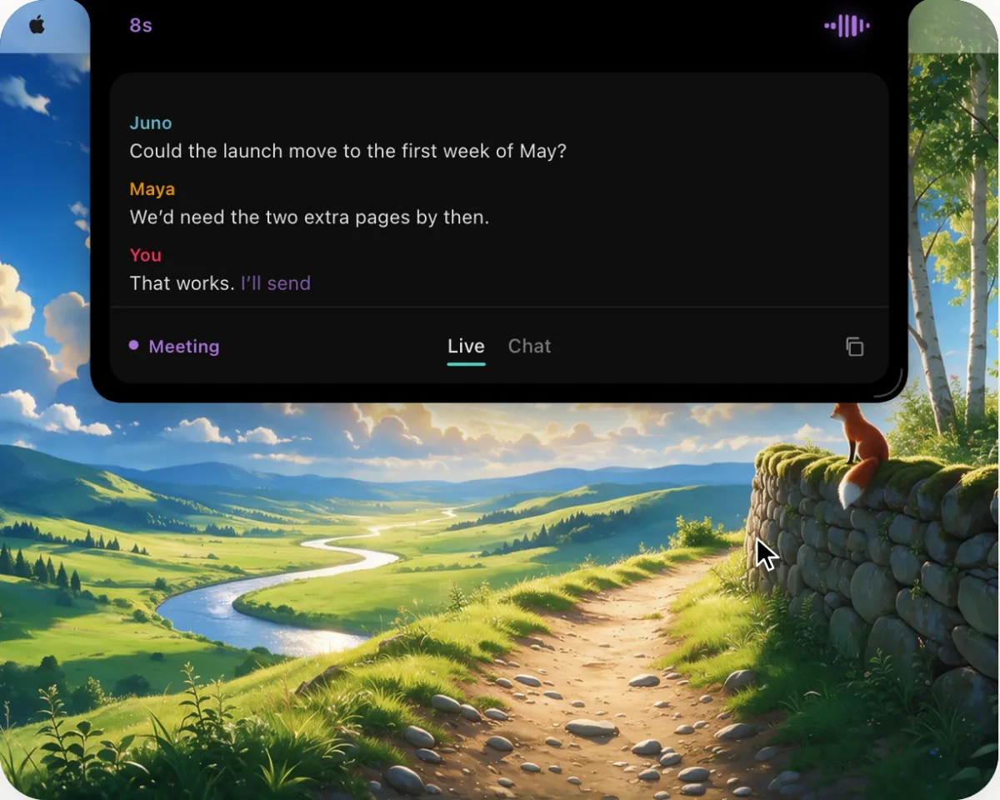
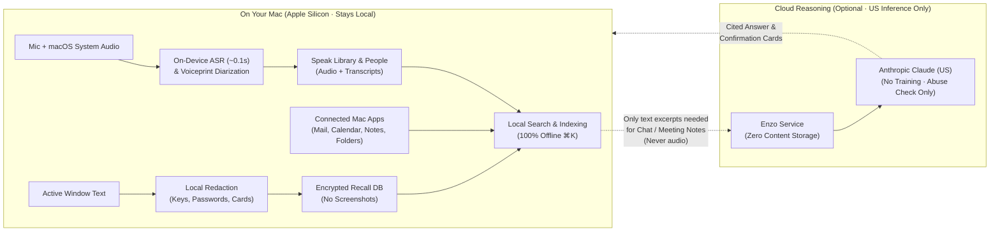

<br>

<p align="center">
  <a href="https://tryenzo.ai/?utm_source=github&utm_campaign=readme">
    <picture>
      <source media="(prefers-color-scheme: dark)" srcset=".github/readme/enzo-lockup-light.svg">
      
    </picture>
  </a>
</p>

<h2 align="center">Your assistant for work, school and life.</h2>

<p align="center">
  <strong>Enzo</strong> (the <a href="https://tryenzo.ai">Enzo Mac app</a> / Enzo AI) is a native macOS assistant that lives in your Mac’s notch or floating island.<br>
  Talk instead of typing, get bot-free meeting notes with every speaker named,<br>
  and ask anything about your work — privately on Apple Silicon.
</p>

<p align="center">
  <a href="https://github.com/selcamx/enzo/releases/latest">
    
  </a>
  
  
  
  
</p>

<p align="center">
  <a href="https://tryenzo.ai/download?from=github_readme">
    <picture>
      <source media="(prefers-color-scheme: dark)" srcset=".github/readme/download-light.svg">
      
    </picture>
  </a>
</p>

<p align="center">
  <sub>Free with no card needed &nbsp;·&nbsp; Signed &amp; notarized DMG &nbsp;·&nbsp; Automatic updates &nbsp;·&nbsp; <a href="https://github.com/selcamx/enzo/releases/latest">Release notes</a></sub>
</p>

<p align="center">
  <a href="#features">Features</a> &nbsp;·&nbsp;
  <a href="#architecture--privacy">Architecture</a> &nbsp;·&nbsp;
  <a href="#performance--specs">Benchmarks</a> &nbsp;·&nbsp;
  <a href="#keyboard-shortcuts">Shortcuts</a> &nbsp;·&nbsp;
  <a href="#how-enzo-compares">Compare</a> &nbsp;·&nbsp;
  <a href="#install--verify">Install</a> &nbsp;·&nbsp;
  <a href="#plans">Plans</a> &nbsp;·&nbsp;
  <a href="#faq">FAQ</a>
</p>

<p align="center">
  <a href="https://tryenzo.ai/?utm_source=github&utm_campaign=readme">Website</a> &nbsp;·&nbsp;
  <a href="https://tryenzo.ai/docs">Docs</a> &nbsp;·&nbsp;
  <a href="https://tryenzo.ai/guides">Guides</a> &nbsp;·&nbsp;
  <a href="https://tryenzo.ai/pricing">Pricing</a> &nbsp;·&nbsp;
  <a href="https://tryenzo.ai/privacy">Privacy</a> &nbsp;·&nbsp;
  <a href="https://github.com/selcamx/enzo/discussions">Discussions</a> &nbsp;·&nbsp;
  <a href="https://x.com/selcamx">X</a>
</p>

<br>

https://github.com/user-attachments/assets/5ffdf7e7-f242-4c8c-8b4d-dc02fa022551

<p align="center"><sub>Enzo in 70 seconds. Screens are redrawn from the app, voices are generated, and the work shown is sample work.</sub></p>

<br>

---

## Features

### 1. Talk instead of typing (`~0.1s`, offline)

Press **Right `⌥`**, talk, press it again. Clean, punctuated text lands at your cursor in **any Mac app** about a tenth of a second after you stop. Enzo transcribes on Apple Silicon while you speak, so there is no 30-second silence cutoff and it works completely offline across **25 European languages**, detected automatically.

<p align="center">
  
</p>

<p align="center"><sub>~100 ms after stopping &nbsp;·&nbsp; 25 European languages &nbsp;·&nbsp; Works offline &nbsp;·&nbsp; Saved in Speak Library</sub></p>

<br>

### 2. Meeting notes without a bot in your call

When a call starts in **Zoom, Google Meet, Microsoft Teams, FaceTime, or Slack Huddles**, Enzo records your microphone and macOS system audio locally — no bot ever waits in the lobby or joins the participant list. It separates speakers acoustically on your Mac, learns voices once you confirm them in **People**, lets you ask **Chat** live during the call, and writes structured notes in the meeting’s language with follow-up drafts when you hang up.

<p align="center">
  
</p>

<p align="center"><sub>No meeting bot &nbsp;·&nbsp; Cross-call voice recognition &nbsp;·&nbsp; Live transcript &amp; mid-call Chat &nbsp;·&nbsp; Audio never leaves your Mac</sub></p>

<br>

### 3. Recall: encrypted work memory with zero screenshots

**Recall** is off until you turn it on. It records the apps, window titles, and readable text from your screen in an encrypted local timeline on your Mac — never a screenshot archive. Passwords, API keys, tokens, card numbers, and private browser windows are redacted or skipped automatically. Search locally with `⌘K` on every plan, or ask Chat about anything you worked on.

<p align="center">
  
</p>

<p align="center"><sub>Opt-in &nbsp;·&nbsp; Encrypted on your Mac &nbsp;·&nbsp; Zero screenshots stored &nbsp;·&nbsp; Pause or exclude any app/site</sub></p>

<br>

### 4. Chat across your workday — without pasting context

Press **Right `⌘`** over any app to open **Chat** in the notch, island, or main window. Ask across your meetings, Recall, attached files (PDF, Office, images), the current screen, and the macOS apps you connect: **Apple Mail, Calendar, Messages, Notes, Reminders, Contacts, and Folders**. Every answer cites its exact sources, replies open as editable drafts in Mail, and nothing is ever sent or modified without your click.

<p align="center">
  
</p>

<p align="center"><sub>Every source linked &nbsp;·&nbsp; Read-only Mac connectors &nbsp;·&nbsp; Confirmation card before every action</sub></p>

<br>

### 5. Routines with the answer already waiting

Turn recurring questions into **Routines** — a morning plan, open follow-ups, after-meeting recaps, or a Friday changelog. Preview any routine on demand on Free, or schedule them on Plus and Pro (`Every weekday`, `Every week`, `Through the day`, or `After each meeting`) with **Only answer when there’s news** so Enzo stays quiet when nothing needs you.

<p align="center">
  
</p>

<p align="center"><sub>Built-in templates or plain-English prompts &nbsp;·&nbsp; Quiet corner cards hidden during screen shares</sub></p>

<br>

### The small details

| | |
| :-- | :-- |
| **Ghost mode** · Automatically hides Enzo’s notch, island, cards, and windows during screen shares | **Notch, island, or window** · Lives in the MacBook camera notch, a draggable 8-spot floating island, or its own window |
| **Auto-record calls** · Starts & stops automatically for Zoom, Teams, FaceTime & Slack; one-click offer for browser calls | **Auto-switches to Meet** · Starts as dictation and detects when a second voice enters the room |
| **Word-level replay** · Double-click any word in Speak to jump audio playback straight to that moment | **Drop in any file** · Drag or paste PDFs, `.docx`, `.xlsx`, `.pptx`, text, or images into Chat or the notch |
| **Music auto-pause** · Pauses Spotify/Apple Music while dictating and resumes when you finish | **Speak stats** · Track weekly dictated words, speaking pace, and time saved over typing |

<br>

---

## Architecture & Privacy

<p align="center">
  
</p>

The Enzo Mac app is a native SwiftUI AI assistant built for Apple Silicon with a strict local-first boundary. Audio, transcripts, voiceprints, chats, and Recall stay in `~/Library/Application Support/Enzo` on your Mac and are never synced or backed up to our servers.



| Runs & stays 100% on your Mac | Uses Cloud AI (Claude, US inference) |
| :-- | :-- |
| Dictation, call recording, and transcription | Chat answers |
| Speaker separation and saved voice profiles | Meeting notes, titles, and follow-ups |
| Recall capture, redaction, encryption, and `⌘K` search | Inbox watching for replies owed & scheduled routines |
| All audio, transcripts, chats, and voiceprints | Recall’s AI labels for stretches of your day |

> [!NOTE]
> **Full control:** Turn off **Meetings** and **Your day in Recall** in **Settings › Privacy**, pause connected apps, and pause routines — zero data leaves your Mac until you explicitly ask a question in Chat. [Read the full privacy boundary →](https://tryenzo.ai/privacy)

<br>

---

## Performance & Specs

| Metric | Detail |
| :-- | :-- |
| **Dictation latency** | `~0.1 s` typical · `~0.25 s` for 7 min · `~2 s` for 1 hr *(M4 Mac, Nov 2026)* |
| **Local model footprint** | `~1.1 GB` total downloaded once during setup *(dictation ready after first `518 MB`)* |
| **Offline capability** | 100% offline for dictation, meeting recording, speaker ID, and local `⌘K` search |
| **Languages** | 25 European languages auto-detected locally *(no cloud fallback)*; app UI in English |
| **Stack** | Native Swift & SwiftUI — zero Electron, signed & Apple-notarized |
| **Requirements** | Apple Silicon Mac (M1, M2, M3, M4 or newer) · macOS 15 Sequoia or later |
| **Screen sharing** | Automatic **Ghost mode** hides notch, island, cards, and windows during calls |

<br>

---

## Keyboard Shortcuts

Every shortcut works globally or inside the Enzo window and can be customized in **Settings › Shortcuts**.

| Shortcut | Action |
| :-- | :-- |
| `Right ⌥` | Start or stop dictation / recording *(customizable to `Right ⌥⌘`, `Left ⌥`, or Double press)* |
| `Right ⌘` | Open Chat in the notch or floating island over any app |
| `⌘ Esc` | Cancel an active recording, stop streaming, or keep a recording Solo |
| `Tab` | Switch between Live transcript and Chat during an active recording |
| `⌘ K` | Instant local search across chats, recordings, and Recall |
| `⌘ 1` – `⌘ 4` | Jump to Speak (`⌘1`), Recall (`⌘2`), Routines (`⌘3`), or Connections (`⌘4`) |
| `⌃ ⇧ D` | Dictate directly into the Chat composer |
| `⌘ ↩` / `⌘ .` | Accept or dismiss a suggested Mail draft, event, or reminder card |

[Full keyboard shortcuts reference →](https://tryenzo.ai/docs/shortcuts)

<br>

---

## How Enzo Compares

| Capability | **Enzo** | [Superwhisper](https://tryenzo.ai/superwhisper-alternative) | [Wispr Flow](https://tryenzo.ai/wispr-flow-alternative) | [Granola](https://tryenzo.ai/granola-alternative-mac) | [Otter](https://tryenzo.ai/otter-alternative-mac) |
| :-- | :-: | :-: | :-: | :-: | :-: |
| **On-device audio (never uploaded)** | ✓ | ✓ *(local models)* | — | — | — |
| **Offline dictation & meetings** | ✓ | ✓ | — | — | — |
| **Bot-free meeting capture** | ✓ | ✓ | ✓ | ✓ | Desktop only |
| **Voice recognition across calls** | ✓ *(local)* | Single-call | Invite-based | Me / Them | Cloud |
| **Saved local meeting audio** | ✓ | ✓ | — | — | Cloud |
| **Encrypted Recall work memory** | ✓ | — | — | — | — |
| **Chat across Mail, Calendar & files** | ✓ | — | — | Meetings only | Meetings only |
| **Paid starting price** | **$10/mo** | $8.49/mo | $15/mo | $14/mo | $16.99/mo |

[See the full 13-app Mac comparison matrix →](https://tryenzo.ai/compare)

<br>

---

## Install & Verify

1. **[Download the latest signed DMG](https://tryenzo.ai/download?from=github_readme)** (or grab any version from [GitHub Releases](https://github.com/selcamx/enzo/releases)).
2. Drag **Enzo.app** into `/Applications` and open it.
3. Sign in with Apple, Google, or an email code (no credit card needed). Local models download automatically in the background while you finish setup, and updates install seamlessly via Sparkle.

You can verify the Apple Developer ID signature and notarization locally at any time:

```bash
spctl --assess --type execute -vv /Applications/Enzo.app
```

> [!TIP]
> **Homebrew Cask:** Homebrew requires 225 GitHub stars before accepting a new cask. Starring this repository helps bring `brew install --cask enzo` to macOS faster.

<br>

---

## Plans

Start free with no time limit and no credit card. Upgrade in the app when you want unlimited dictation, more meeting minutes, full-history Chat, and scheduled routines.

| What you get | Free<br><sub>$0</sub> | Plus<br><sub>$10 / month</sub> | Pro<br><sub>$20 / month</sub> |
| :-- | :-: | :-: | :-: |
| Dictation into your apps* | 5,000 words / week | **Unlimited** | **Unlimited** |
| Meetings with speaker notes* | 60 minutes / week | 180 minutes / week | **Unlimited** |
| Weekly AI allowance* | Included | 5× Free | 20× Free |
| Chat effort | Low | Low, Medium & High | Low, Medium & High |
| Chat memory | Today & last working day | All your history | All your history |
| Scheduled routines | Try on demand | ✓ | At High effort |
| Your day in Recall named by AI | First finished day | ✓ | ✓ |
| Finds replies you owe in Mail & Messages | Once a day | Every 15 minutes | Every 15 minutes |

Every plan includes local voice-based speaker recognition, local Recall timeline & search, every connected Mac app, Mail drafts, and local-only storage on your Mac.

**14-day money-back guarantee on Plus and Pro.** Request a full refund within 14 days of your first payment in **Settings › Billing** or at [hello@tryenzo.ai](mailto:hello@tryenzo.ai), and cancel anytime. Annual billing includes two months free ($100/year for Plus, $200/year for Pro).

<sub>*Past a weekly limit, new dictation or meeting recording waits until your weekly reset; a recording already under way always finishes, and everything saved stays readable. AI usage renews every week; longer questions and higher effort use more.</sub>

<br>

---

## FAQ

<details>
<summary><b>How do I get started?</b></summary>
<br>

Download Enzo, sign in with Apple, Google, or an email code, and pick Notch or Island. Enzo downloads its local speech, speaker, and text models (~1.1 GB) while you walk through setup, and dictation is ready after the first 518 MB: press Right `⌥` and talk.

</details>

<details>
<summary><b>Does Enzo upload my recordings or Recall?</b></summary>
<br>

No. Audio, transcripts, chats, voice profiles, and Recall are stored locally on your Mac and never synced to our servers. Speech and speaker recognition run locally on Apple Silicon. Only when Chat answers a question or writes meeting notes does Enzo send the needed text excerpts to Claude (US inference). Our service keeps none of it, and Anthropic never trains on it.

</details>

<details>
<summary><b>Why do I need an account to use Free?</b></summary>
<br>

A free Enzo account signs you in, applies your plan, and tracks your weekly allowances across your Macs, with no credit card required. It never stores your recordings, transcripts, chats, or Recall.

</details>

<details>
<summary><b>Does a bot join my meetings?</b></summary>
<br>

No. Enzo captures your Mac’s microphone and system audio directly, so no bot joins the invite or participant list. It works across Zoom, Google Meet, Microsoft Teams, FaceTime, Slack Huddles, and in-person rooms, and Ghost mode hides Enzo automatically during screen shares. Letting participants know you are recording is up to you, as with any local recorder.

</details>

<details>
<summary><b>Can Enzo send emails or change my calendar on its own?</b></summary>
<br>

Never. You choose which Mac apps to connect (Mail, Calendar, Messages, Notes, Reminders, Contacts, and Folders), and Enzo reads them read-only. Replies open as editable drafts in Mail, and calendar events or reminders wait for you to confirm them.

</details>

<details>
<summary><b>Which Macs, external monitors, and languages are supported?</b></summary>
<br>

Any Mac with Apple Silicon (M1 or newer) running macOS 15 Sequoia or later. On external displays without a notch, Enzo sits neatly at the top edge or as a movable floating island. Dictation and meetings support 25 European languages automatically, and post-meeting notes match the language spoken in the meeting. The app interface is in English.

</details>

<details>
<summary><b>I used Chirp. What happens to it?</b></summary>
<br>

Chirp keeps working on your Mac and won’t receive further updates. Enzo 2.0 is a new app that starts fresh without importing Chirp’s recordings, settings, or license. Releases prior to 2.0 in this repository are historical Chirp builds.

</details>

<br>

---

## Support & Community

The fastest way to report a bug or request a feature is right inside Enzo: choose **Help › Send Feedback…** in the menu bar. It opens an issue here with your app and macOS versions, sends sanitized diagnostics privately, and can credit you by first name.

- **Feature ideas & Q&A:** [GitHub Discussions](https://github.com/selcamx/enzo/discussions)
- **Bug reports & feature requests:** [Open an issue](https://github.com/selcamx/enzo/issues/new/choose)
- **Documentation & troubleshooting:** [tryenzo.ai/docs](https://tryenzo.ai/docs)
- **Changelog:** [CHANGELOG.md](CHANGELOG.md) · [All releases](https://github.com/selcamx/enzo/releases)
- **Account, billing & private support:** [hello@tryenzo.ai](mailto:hello@tryenzo.ai)
- **Security vulnerabilities:** [SECURITY.md](SECURITY.md)

## About this repository

This public repository hosts Enzo’s signed macOS releases, changelog, issue tracker, and community discussions. Enzo is proprietary software: its source code is private, and use of the app is governed by the [Terms of Service](https://tryenzo.ai/terms).

<br>

<p align="center">
  Built for macOS by <a href="https://github.com/selcamx">Selim Cam</a> &nbsp;·&nbsp; Follow updates on <a href="https://x.com/selcamx">X</a><br>
  <sub>If Enzo saves you time, please consider starring this repository — it helps other Mac users discover it.</sub>
</p>
