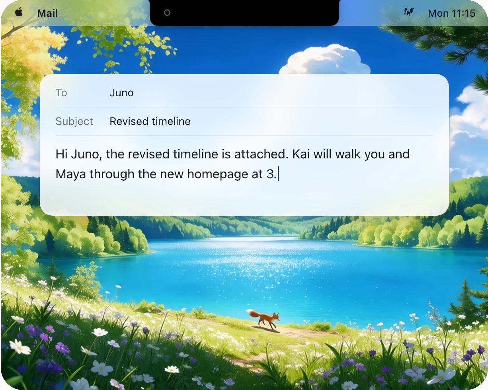
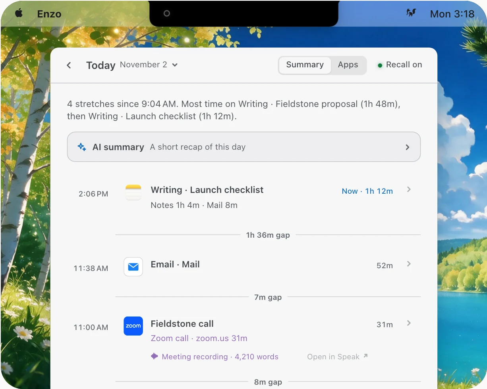
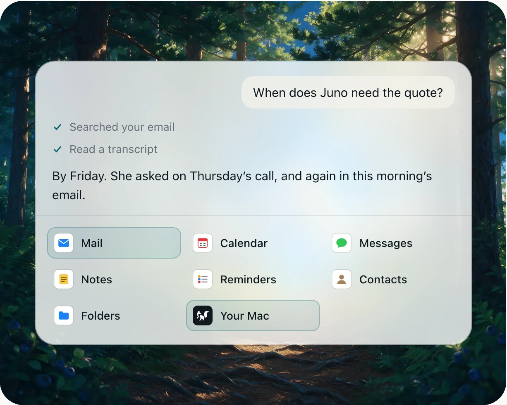
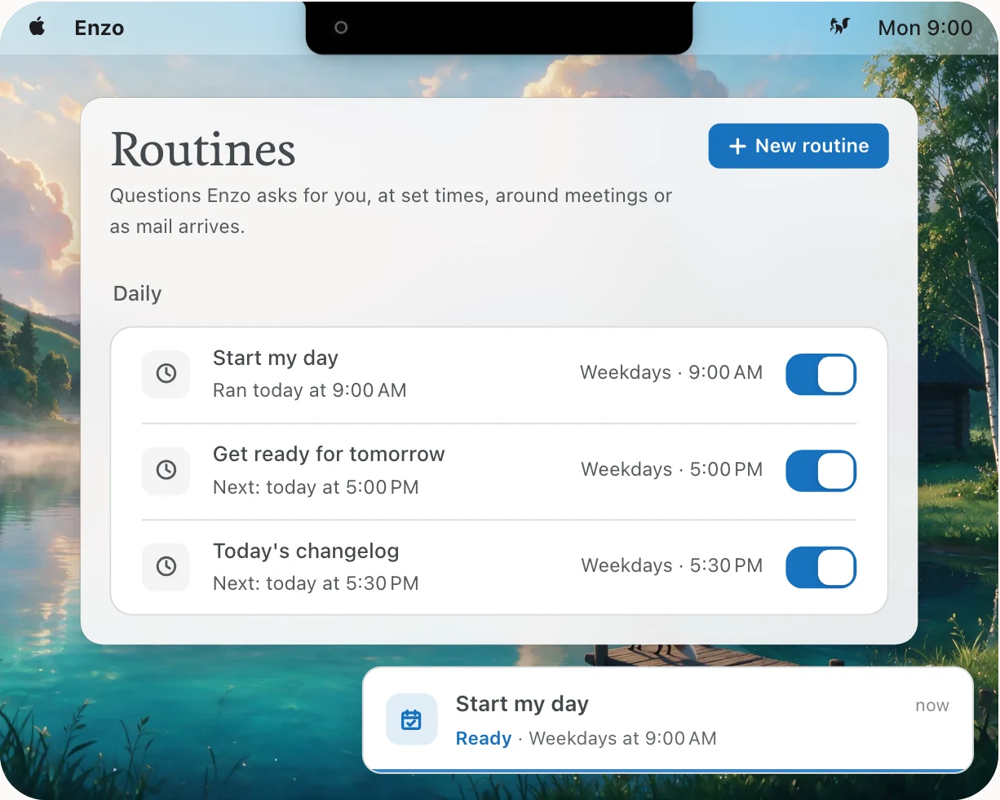

 

  <a href="https://tryenzo.ai/?utm_source=github&utm_campaign=readme">
    <picture>
      <source media="(prefers-color-scheme: dark)" srcset=".github/readme/enzo-lockup-light.svg">
      
    </picture>
  </a>

<h2 align="center">Your assistant for work, school and life.</h2>

  Talk instead of typing, get notes with every speaker named, 
  and ask anything about your work, privately on your Mac.

  <a href="https://tryenzo.ai/download?from=github_readme">
    <picture>
      <source media="(prefers-color-scheme: dark)" srcset=".github/readme/download-light.svg">
      
    </picture>
  </a>

  No card needed &nbsp;·&nbsp; Apple Silicon (M1 or newer) &nbsp;·&nbsp; macOS 15+ &nbsp;·&nbsp; Signed &amp; notarized &nbsp;·&nbsp; <a href="https://github.com/selcamx/enzo/releases/latest">Latest release</a>

  <a href="https://tryenzo.ai/?utm_source=github&utm_campaign=readme">Website</a> &nbsp;·&nbsp;
  <a href="https://tryenzo.ai/pricing">Pricing</a> &nbsp;·&nbsp;
  <a href="https://tryenzo.ai/privacy">Privacy</a> &nbsp;·&nbsp;
  <a href="https://tryenzo.ai/docs">Docs</a> &nbsp;·&nbsp;
  <a href="https://tryenzo.ai/guides">Guides</a> &nbsp;·&nbsp;
  <a href="https://tryenzo.ai/releases">Release notes</a> &nbsp;·&nbsp;
  <a href="https://x.com/selcamx">X</a>

 

https://github.com/user-attachments/assets/5ffdf7e7-f242-4c8c-8b4d-dc02fa022551

Enzo in 70 seconds. The screens are redrawn from the app, the voices are generated, and the work is sample work.

 

## Talk instead of typing

Press Right `⌥`, talk, press it again. Clean, punctuated text lands at your cursor
in any app, about a tenth of a second after you stop. Enzo transcribes on your
Mac while you speak, so it works with Wi-Fi off across 25 European languages it
tells apart on its own.

  

Ready in about 100 ms &nbsp;·&nbsp; 25 European languages &nbsp;·&nbsp; Works offline

 

## Meeting notes without a bot in your call

When a call starts, Enzo offers to record it directly from your Mac’s audio, so
no bot joins the invite. It tells every person apart by voice, on a call or
around one mic in a room, and once you name someone in **People** it recognizes
them in future meetings. Ask about the call while it’s still live. When it ends,
the transcript is ready in seconds, and Enzo writes the notes in the meeting’s
language along with your follow-ups.

  

Zoom, Meet, Teams, FaceTime and rooms &nbsp;·&nbsp; Who said what, by name &nbsp;·&nbsp; Audio never leaves your Mac

 

## Find anything you saw or worked on

**Recall** is off until you turn it on. It saves the apps, window titles, and
readable text from your screen in an encrypted timeline on your Mac, so you can
search your day or ask Chat about it later. It keeps text rather than a
screenshot archive, and passwords, API keys, and card numbers are redacted
before anything is stored.

  

Off until you turn it on &nbsp;·&nbsp; No screenshot archive &nbsp;·&nbsp; Pause it, or exclude any app or site

 

## Ask anything without pasting context

Press Right `⌘` in any app and ask. **Chat** answers from your meetings, Recall,
a document you drop in, what’s on your screen, and the Mac apps you connect:
Mail, Calendar, Messages, Notes, Reminders, Contacts, and Folders. Every answer
links the exact sources it read, and Chat’s home screen surfaces replies you owe
and upcoming dates. Replies open as drafts in Mail, and nothing is sent or added
until you confirm it.

  

Every source linked &nbsp;·&nbsp; Nothing sent without your click &nbsp;·&nbsp; You choose which apps connect

 

## Routines with the answer waiting

A **routine** is a recurring question Enzo runs for you at a set time, like a
morning plan, open follow-ups, or an end-of-day recap, so the answer is ready
when you sit down. Start from built-in templates or write your own, preview any
routine on demand on Free, and run them on a schedule on Plus and Pro.

  

Daily, weekdays, weekly or monthly &nbsp;·&nbsp; Built-in templates or custom prompts

 

## The small things

| | |
| :-- | :-- |
| **Ghost mode** · Hides Enzo’s windows and notch automatically when you share your screen | **Notch, island, or window** · Lives in the camera notch, a movable floating island, or its own window |
| **Call detection** · Notices Zoom, Meet, Teams, or FaceTime starting and offers to record | **Auto-switches to Meet** · Starts as dictation and switches when a second voice joins |
| **Live meeting Chat** · Ask what was decided so far while the call is still going | **Click to replay** · Jump to the exact moment something was said in **Speak** |
| **Drop in any file** · Attach PDFs, spreadsheets, images, or docs and ask about them | **Screen awareness** · Ask Chat about whatever window is open in front of you |
| **Music auto-pause** · Pauses playback while you dictate and resumes when you finish | **Speak stats** · Track dictated words, time saved, and monthly activity on your Mac |

 

## Built for your Mac, not our servers

  

Enzo AI is a native macOS assistant built for Apple Silicon. Listening, speaker
recognition, and Recall run locally on your Mac, while Cloud AI is used only for
reasoning when Chat answers a question, writes meeting notes, or runs a routine.

| Runs & stays on your Mac | Uses Cloud AI (Claude) |
| :-- | :-- |
| Dictation, call recording, and transcription | Chat’s answers |
| Speaker separation and voice recognition | Meeting notes, titles, and follow-ups |
| Recall capture, encryption, and local search | Replies you owe and scheduled routines |
| Your audio, transcripts, chats, and voice profiles | Recall’s AI titles for each stretch of your day |

- **Local on Apple Silicon.** Audio, transcripts, chats, voice profiles, and Recall live in local files on your Mac, never synced or backed up to our servers. Deleting a recording, a person, or a day erases it immediately.
- **Cloud AI only for reasoning.** When Chat answers a question or writes notes, only the relevant excerpts (or an attached file or screen view when text isn’t enough) go through Enzo’s service to Claude. Our service stores none of it, and Anthropic never trains on it.
- **Off until you say yes.** Recall starts off, Mac apps connect only when you choose them, and **Settings › Privacy** controls everything Enzo’s AI does automatically.
- **Works offline.** Once local models finish downloading during setup, dictation, meeting recording, speaker recognition, and local search work without internet.

[Read how Enzo protects your data →](https://tryenzo.ai/privacy)

 

## Plans

Start free with no time limit and no credit card. Upgrade in the app when you
want unlimited dictation, more meeting minutes, full-history Chat, and scheduled
routines.

| What you get | Free $0 | Plus $10 / month | Pro $20 / month |
| :-- | :-: | :-: | :-: |
| Dictation into your apps* | 5,000 words / week | **Unlimited** | **Unlimited** |
| Meetings with speaker notes* | 60 minutes / week | 180 minutes / week | **Unlimited** |
| Weekly AI allowance* | Included | 5× Free | 20× Free |
| Chat effort | Low | Low, Medium & High | Low, Medium & High |
| Chat memory | Today & last working day | All your history | All your history |
| Scheduled routines | Try on demand | ✓ | At High effort |
| Your day in Recall named by AI | First finished day | ✓ | ✓ |
| Finds replies you owe in Mail & Messages | Once a day | Every 15 minutes | Every 15 minutes |

Every plan names who spoke by voice, includes local Recall timeline and search,
reads every Mac app you connect, opens replies as drafts in Mail, and keeps your
history on your Mac.

**14-day money-back guarantee on Plus and Pro.** Request a full refund within 14
days of your first payment from **Settings › Billing** or by emailing
[hello@tryenzo.ai](mailto:hello@tryenzo.ai), and cancel anytime. Annual billing
gives you two months free ($100/year for Plus, $200/year for Pro).

*Past a weekly limit, new dictation or meeting recording waits until your weekly reset; a recording already under way always finishes, and everything saved stays readable. AI usage renews every week. Long questions and High effort use more.

 

## Questions

<b>How do I get started?</b>

 

Download Enzo, sign in with Apple, Google, or an email code, and choose Notch or
Island. Enzo downloads its local speech, speaker, and text models (about 1.1 GB)
while you walk through setup, and dictation is ready after the first 518 MB:
press Right `⌥` and talk.

<b>Does Enzo upload my recordings or Recall?</b>

 

No. Audio, transcripts, chats, voice profiles, and Recall are stored on your Mac
and never synced to our servers. Speech and speaker recognition run locally on
Apple Silicon. Only when Chat answers a question or writes meeting notes does
Enzo send the needed text excerpts to Claude. Our service keeps none of it, and
Anthropic never trains on it.

<b>Why do I need an account to use Free?</b>

 

A free Enzo account signs you in, applies your plan, and tracks your weekly
allowances across your Macs, with no credit card required. It never stores your
recordings, transcripts, chats, or Recall.

<b>Does a bot join my meetings?</b>

 

No. Enzo captures your Mac’s mic and system audio directly, so no bot joins the
invite or participant list. It works across Zoom, Google Meet, Microsoft Teams,
FaceTime, Slack Huddles, and in-person rooms, and Ghost mode hides Enzo
automatically when you share your screen. Letting people know they’re being
recorded is up to you, as with any recorder.

<b>How fast is dictation, and does it work offline?</b>

 

Typical dictations appear about 0.1 seconds after you stop speaking. Because
Enzo transcribes on your Mac while you talk, a seven-minute dictation finishes
in about 0.25 seconds and an hour-long one in about two seconds (M4 Mac,
November 2026). Dictation, meeting recording, speaker recognition, and local
search all work 100% offline; only Chat and AI notes need internet.

<b>Can Enzo send emails or change my calendar on its own?</b>

 

Never. You choose which Mac apps to connect (Mail, Calendar, Messages, Notes,
Reminders, Contacts, and Folders), and Enzo reads them read-only. Replies open
as editable drafts in Mail, and calendar events or reminders wait for you to
confirm them.

<b>Which Macs, external monitors, and languages are supported?</b>

 

Any Mac with Apple Silicon (M1 or newer) running macOS 15 Sequoia or later. On
external displays without a notch, Enzo sits neatly at the top edge or as a
movable floating island. Dictation and meetings support 25 European languages
automatically, and post-meeting notes match the language spoken in the meeting.
The app interface is in English.

<b>I used Chirp. What happens to it?</b>

 

Chirp keeps working on your Mac, and won’t receive further updates. Enzo 2.0 is
a new app that starts fresh without importing Chirp’s recordings, settings, or
license. Releases prior to 2.0 in this repository are historical Chirp builds.

 

## Support

Found a bug or have a feature request? The fastest path is inside Enzo: choose
**Help › Send Feedback…** in the menu bar. It opens an issue here with your app
and macOS version, sends sanitized diagnostics to us privately, and can credit
you by first name.

- **Bug reports & feature requests:** [Open an issue](https://github.com/selcamx/enzo/issues/new/choose)
- **Setup, permissions & shortcuts:** [Documentation](https://tryenzo.ai/docs)
- **Account, billing & private support:** [hello@tryenzo.ai](mailto:hello@tryenzo.ai)
- **Security vulnerabilities:** See [SECURITY.md](SECURITY.md)

## About this repository

This public repository hosts Enzo’s signed macOS releases, release notes, and
issue tracker. Enzo is proprietary software: its source code is private, and use
of the app is governed by the [Terms of Service](https://tryenzo.ai/terms).

Built by [Selim Cam](https://github.com/selcamx) · Follow updates on [X](https://x.com/selcamx).
If Enzo saves you time, starring this repository helps others discover it.
