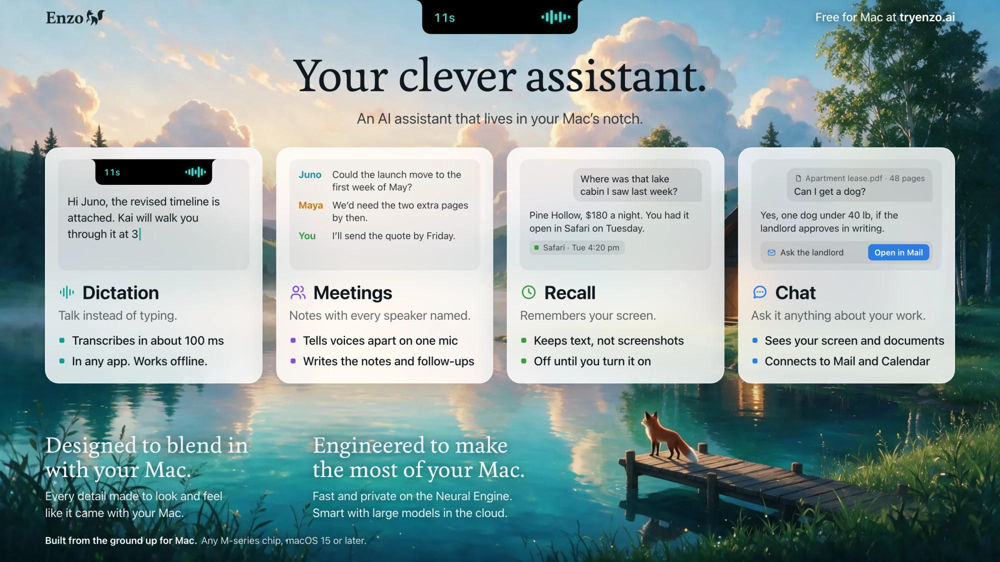
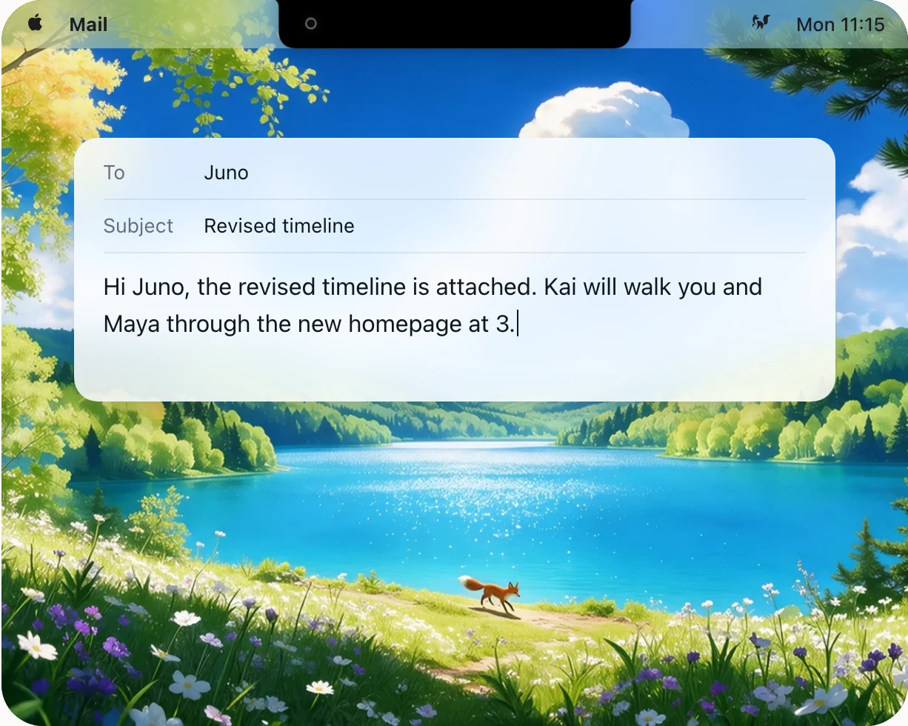
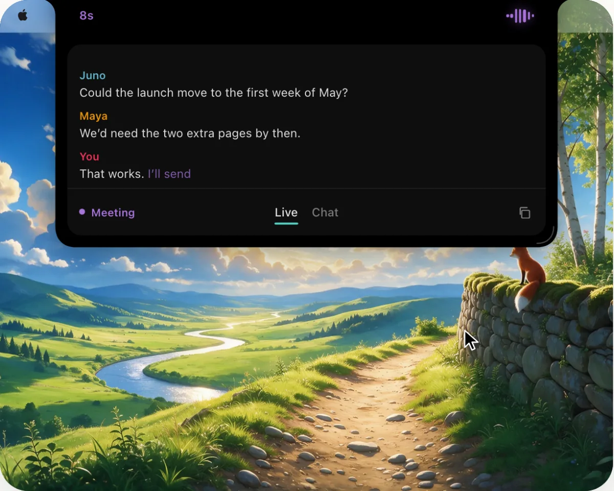
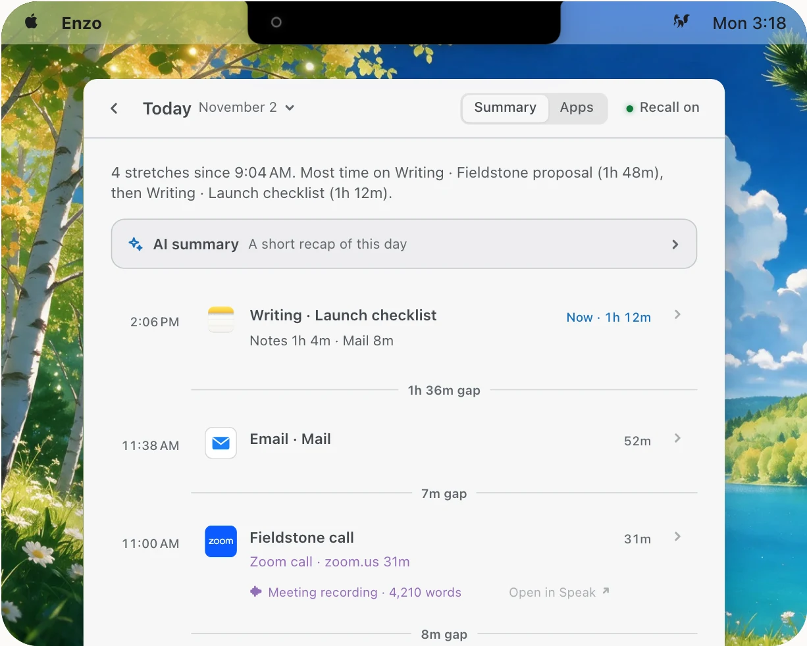
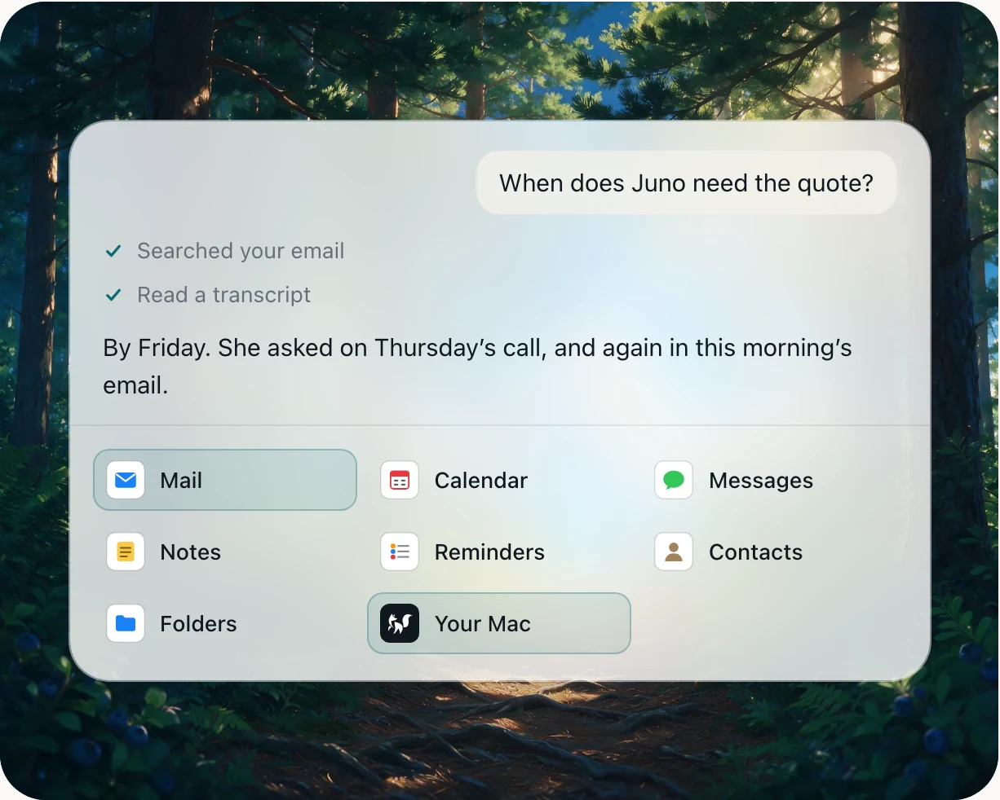
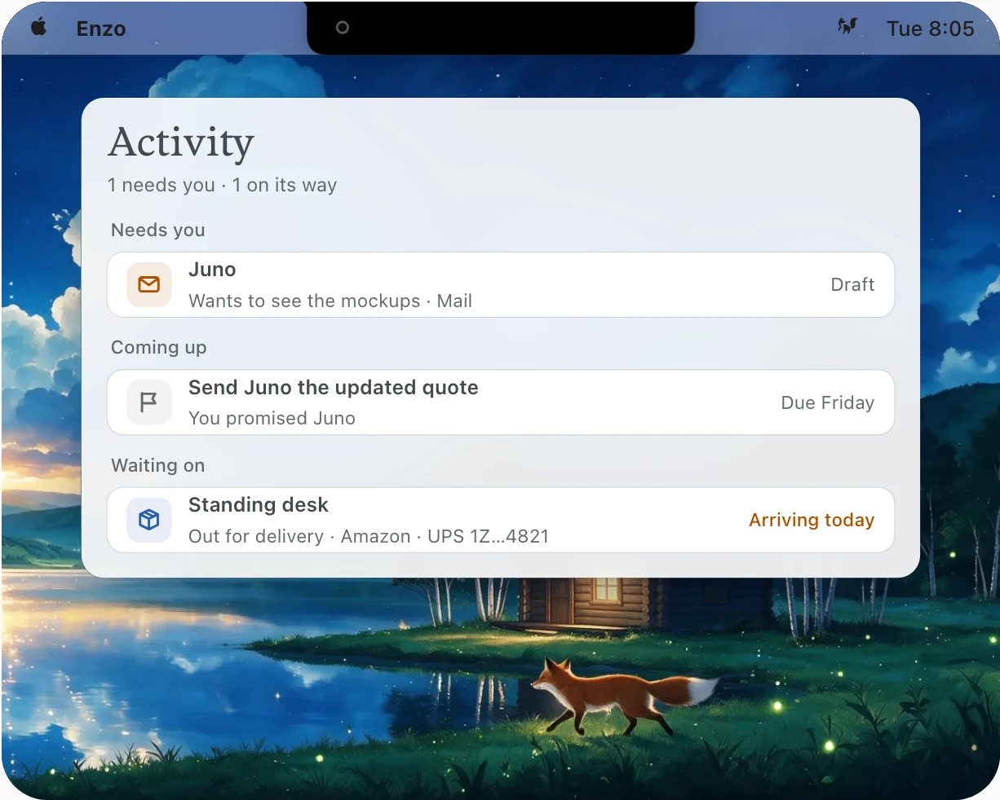
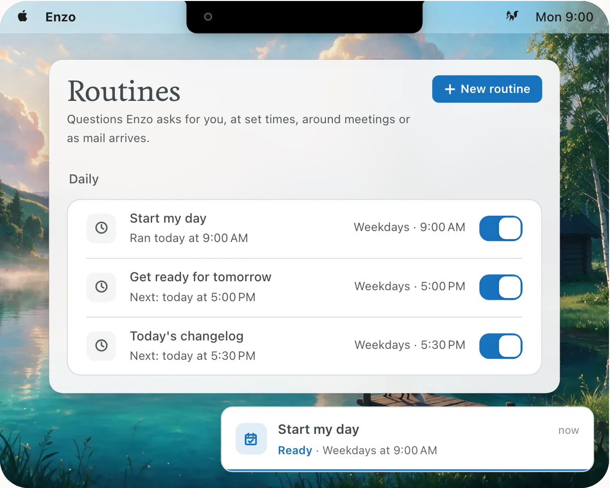

  <a href="https://tryenzo.ai/?utm_source=github&utm_campaign=readme">
    <picture>
      <source media="(prefers-color-scheme: dark)" srcset=".github/readme/enzo-at-a-glance-dark.webp">
      
    </picture>
  </a>

<h3 align="center">Enzo is an AI assistant that lives in your Mac’s notch.</h3>

  Talk instead of typing, let it take the notes in your meetings, 
  and ask it anything about your work.

  <a href="https://tryenzo.ai/download?from=github_readme">
    <picture>
      <source media="(prefers-color-scheme: dark)" srcset=".github/readme/download-light.svg">
      
    </picture>
  </a>

  Free, no card needed &nbsp;·&nbsp; Apple silicon &nbsp;·&nbsp; macOS 15 or later

  <a href="https://tryenzo.ai/?utm_source=github&utm_campaign=readme">Website</a> &nbsp;·&nbsp;
  <a href="https://tryenzo.ai/pricing">Pricing</a> &nbsp;·&nbsp;
  <a href="https://tryenzo.ai/privacy">Privacy</a> &nbsp;·&nbsp;
  <a href="https://tryenzo.ai/guides">Guides</a> &nbsp;·&nbsp;
  <a href="https://tryenzo.ai/releases">Release notes</a> &nbsp;·&nbsp;
  <a href="https://x.com/selcamx">X</a>

 

## Talk instead of typing

Press Right ⌥, talk, press it again. Clean, punctuated text lands at your cursor
in any app, about a tenth of a second after you stop. Enzo transcribes on your
Mac while you speak, so it works with Wi-Fi off, in 25 languages it tells apart
on its own.

  

Ready in about 100 ms &nbsp;·&nbsp; In any app on your Mac &nbsp;·&nbsp; Works offline

 

## Notes with every speaker named

When a call starts, Enzo offers to record it from your Mac, so no bot joins. It
tells every person apart by their voice, on a call or around one mic in a room,
and once you’ve named someone it knows them in every meeting after. Ask about the
call while it’s on. When it ends, the transcript is ready in seconds, and Enzo
writes the notes and your follow-ups.

  

Zoom, Meet, Teams and FaceTime &nbsp;·&nbsp; Who said what, by name &nbsp;·&nbsp; Audio never leaves your Mac

 

## Remembers your screen

Turn on **Recall** and Enzo keeps the apps, window titles and text on your screen,
encrypted on your Mac, so you can find any of it again and Chat can answer from
it. It keeps text, never screenshots, and passwords, API keys and card numbers
are hidden before anything is kept.

  

Off until you turn it on &nbsp;·&nbsp; No screenshots kept &nbsp;·&nbsp; Pause it, or keep apps and sites out

 

## Ask it anything about your work

Press Right ⌘ in any app and ask. **Chat** answers from your meetings, what Recall
kept, a document you drop in, what’s on your screen, and the apps you connect:
Mail, Calendar, Reminders, Contacts, Notes, Messages and your folders. Every
answer links what it used. Enzo drafts the reply or the calendar event, and
nothing is sent until you confirm it.

  

Nothing to explain or paste in &nbsp;·&nbsp; Nothing sent without your click &nbsp;·&nbsp; You choose what it can read

 

## Keeps track so you don’t have to

Once your mail and calendar are connected, Enzo lists what needs you, what’s coming
up and what you’re waiting on, all in one place: **Activity**.

  

Packages, returns, bills and renewals &nbsp;·&nbsp; Replies you owe, and what’s coming up &nbsp;·&nbsp; On Plus, the notch tells you what changed

 

## Has the answer waiting

A **routine** is a question Enzo asks for you at a set time, like what’s on today
and what you still owe. The answer is ready when you get there.

  

Every day, weekdays, weekly or monthly &nbsp;·&nbsp; Start from one of Enzo’s, or write your own &nbsp;·&nbsp; On every plan

 

## The small things

  

 

## Built for the Mac

**Designed to blend in with your Mac.** Enzo is a native Mac app. It lives in the
notch, on a small island at any edge of your screen, or in its own window, and
every detail is made to look and feel like it came with your Mac.

**Engineered to make the most of your Mac.** The listening runs on your Mac’s
Neural Engine, which is why dictation is fast, works offline and never sends
audio anywhere. The thinking comes from a large model in the cloud, which gets
only what a question or a task needs.

| On your Mac | With Enzo’s cloud AI |
| :-- | :-- |
| Dictation, recording and transcription | Chat’s answers |
| Telling speakers apart and recognizing voices | Meeting notes, titles and follow-ups |
| Recall: reading, keeping and searching your screen’s text | The replies you owe, and trackers you start |
| Your recordings, transcripts, chats and voice profiles | Recall’s names for each stretch of your day |

 

## Keeps everything to itself

  

**Stays on your Mac.** Recordings, transcripts, chats and Recall are stored on your
Mac, never synced or backed up to our servers. Transcription runs there too, so
audio never leaves.

**Only what’s needed leaves.** Chat, notes and Enzo’s other AI features send what
they need, like your question, a meeting’s transcript or, when the text isn’t
enough, a picture of your screen or a file you attached, through Enzo’s service to
an AI provider. The service keeps none of it, and the provider keeps it only
briefly to check for abuse.

**You choose what runs.** Enzo works from the apps you connect, and Settings shows
what its AI does on its own. Recall starts off. Pause any app, keep apps and sites
out, or delete what was saved, whenever you like.

**Works without internet.** Dictation, recording and transcription need no
connection. Only Chat and Enzo’s other AI features do.

[How Enzo handles your data →](https://tryenzo.ai/privacy)

 

## Plans

Free has no time limit. Plans differ in how much you can dictate and record each
week, and in the AI on top.

| | Free $0 | Plus $10 a month | Pro $20 a month |
| :-- | :-: | :-: | :-: |
| Dictation into your apps* | 5,000 words a week | 30,000 words a week | Unlimited |
| Meetings with transcripts, speaker names and notes* | 60 minutes a week | 360 minutes a week | Unlimited |
| AI usage* | Included | 6× Free | 3× Plus |
| Chat effort | Low | Low, Medium and High | Low, Medium and High |
| Answers drawn from | Today and your last working day | All your history | All your history |
| Replies Enzo drafts | Open in your mail app | Open in your mail app | Open in your mail app |
| Inbox watched for bills, deliveries and dates | Once a day | Every 15 minutes | Every 15 minutes |
| Trackers: ask Chat to keep track of something | | ✓ | ✓ |
| Recall names each stretch of your day | Your first finished day | ✓ | ✓ |
| Follow-ups and routines at High effort | | | ✓ |

**14-day money-back guarantee on Plus and Pro.** Write to
[hello@tryenzo.ai](mailto:hello@tryenzo.ai) within 14 days of your first payment for
a full refund, and cancel anytime. Paying yearly gets you two months free: $100 for
Plus, $200 for Pro. Plans are chosen and managed in the app.

*Past a weekly limit, dictation or meeting recording waits until it resets; a meeting already under way still finishes. AI usage renews every 5 hours, within a weekly limit. Long questions and High effort use more. On Free, notes and follow-ups come out of the same weekly limit.

 

## Questions

<b>How do I get started?</b>

 

Download Enzo, sign in with Apple, Google or an email code, and allow the permissions
it asks for. Enzo downloads its models (about 1.1 GB), and dictation is ready after
the first 520 MB: press Right ⌥ and talk.

<b>Why do I need an account?</b>

 

A free Enzo account signs you in, applies your plan and measures your AI usage
across your Macs. It holds no recordings or history; those stay on your Mac.

<b>Does a bot join my meetings?</b>

 

No. Enzo records the meeting from your Mac’s own audio, so it works with Zoom, Meet,
Teams, FaceTime and other calling apps without inviting a bot. Letting people know
they’re being recorded is up to you, as with any recorder.

<b>How fast is dictation?</b>

 

About a tenth of a second from when you stop talking to your words as text, for a
typical dictation. Enzo transcribes on your Mac while you speak, so little is left
when you stop: a seven-minute dictation is ready in about a quarter of a second, and
an hour-long one in about two (M4 Mac, measured November 2026).

<b>Does it work offline?</b>

 

Dictation, recording and transcription do, once the models are downloaded.
Chat and other AI features need a connection.

<b>What does Recall keep?</b>

 

Recall is off until you turn it on. It keeps the apps, window and document titles
and the readable text on your screen, encrypted on your Mac, and deletes it after
30 days unless you choose another period. It never keeps a screenshot archive. You
can pause it, exclude apps and sites, and delete what it kept at any time.

<b>Which languages does it support?</b>

 

Dictation and meetings work in 25 European languages, including English, Spanish,
French and German, and Enzo tells which on its own. The app itself is in English.

<b>What does Enzo keep track of?</b>

 

Once Apple Mail is connected: packages, returns, refunds, renewals,
bills, school work, invitations and appointments. Enzo reads the sender, subject and
preview of new mail on your Mac, by rules and with no AI, and lists what it finds in
Activity. With its AI working on its own, it also finds the replies you owe, sending
the sender, subject and a short preview of those messages to do it.

<b>Will Enzo send things on its own?</b>

 

No. Enzo drafts replies, reminders and calendar events, and creates or sends
one only when you confirm it.

<b>Which Macs does it run on?</b>

 

Apple silicon Macs, M1 or newer, with macOS 15 or later. On a screen without a
notch, Enzo sits at the top of the screen, or on its island.

<b>I use Chirp. What happens to it?</b>

 

Chirp keeps working on your Mac, but it won’t get any more updates. Enzo is a new
app that starts fresh: it doesn’t bring over Chirp’s recordings, settings or
license. If you bought Chirp, look out for an email from us. Older release notes
still say Chirp, because that was the name at the time.

 

## Support

Found a bug or want something changed? Tell us from Enzo: choose
**Help › Send Feedback…** in the menu bar. It opens an issue here, sends any
diagnostics to us privately, and can credit you by first name. You can also
[open an issue](https://github.com/selcamx/enzo/issues/new/choose) yourself. For private
support, billing or your account, email [hello@tryenzo.ai](mailto:hello@tryenzo.ai).
To report a security problem, see the [security policy](SECURITY.md).

## About this repository

This repository holds Enzo’s releases, their notes and its issue tracker. Enzo itself
is proprietary software: its source code is private and isn’t published here, and the
app is licensed to you under the [Terms of Service](https://tryenzo.ai/terms). The
releases before 2.0 are Chirp, Enzo’s earlier name.

Enzo is built by Selim Cam. Follow along on [X](https://x.com/selcamx). If Enzo
helps you, starring this repository helps other people find it.
