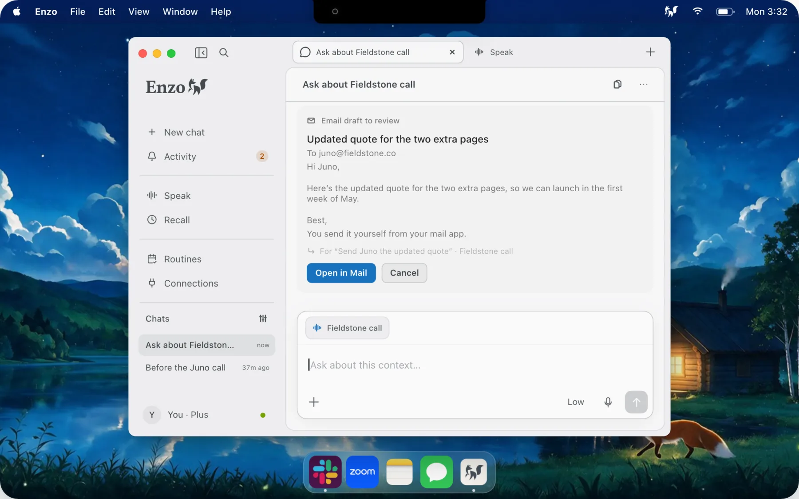
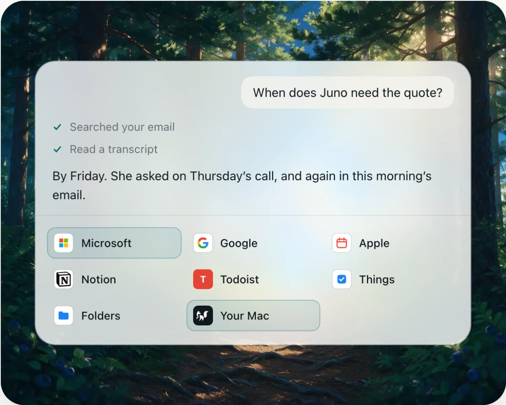

  <a href="https://tryenzo.ai">
    <picture>
      <source media="(prefers-color-scheme: dark)" srcset=".github/readme/enzo-lockup-light.svg">
      
    </picture>
  </a>

<h3 align="center">Your clever assistant.</h3>

  Enzo sits in on your meetings, types what you say, remembers what you worked on 
  and keeps track of what’s next. Your history stays on your Mac.

  <a href="https://tryenzo.ai">
    <picture>
      <source media="(prefers-color-scheme: dark)" srcset=".github/readme/coming-soon-light.svg">
      
    </picture>
  </a>

  Free, no card needed &nbsp;·&nbsp; 5,000 dictated words and 50 meeting minutes a week &nbsp;·&nbsp; Apple silicon, macOS 15 or later

  <a href="https://tryenzo.ai">Website</a> &nbsp;·&nbsp;
  <a href="https://tryenzo.ai/pricing">Pricing</a> &nbsp;·&nbsp;
  <a href="https://tryenzo.ai/privacy">Privacy</a> &nbsp;·&nbsp;
  <a href="https://tryenzo.ai/releases">Release notes</a> &nbsp;·&nbsp;
  <a href="https://github.com/selcamx/enzo/issues">Get help</a>

 

  

 

## Type at the speed of sound

Press a key, talk, press it again. Clean, punctuated text lands at your cursor
in any app on your Mac.

  

5,000 words a week on Free &nbsp;·&nbsp; Works offline &nbsp;·&nbsp; In any app on your Mac

 

## Sits in on every meeting

Enzo records from your Mac, so no bot joins the call. It knows who said what,
answers while the call is on, and writes the notes after.

  

Zoom, Meet, Teams and FaceTime &nbsp;·&nbsp; Who said what, by name &nbsp;·&nbsp; Ask about the call while it’s on

 

## Already knows your apps

Connect Apple Mail or a personal Outlook account, your calendar, Notion and your
folders, and Enzo answers from them alongside your meetings. Turn on **Recall** and
it remembers what you worked on too: the apps, titles and text, never screenshots,
so you can find the proposal you had open last Tuesday.

  

Nothing to explain or paste in &nbsp;·&nbsp; Nothing sent without your click &nbsp;·&nbsp; You choose what it can read

 

## Keeps track so you don’t have to

Once your mail and calendar are connected, Enzo lists what needs you, what’s coming
up and what you’re waiting on, all in one place: **Activity**.

  

Packages, returns, bills and renewals &nbsp;·&nbsp; Replies you owe, and who owes you one &nbsp;·&nbsp; On Plus, the notch tells you what changed

 

## Keeps everything to itself

  

**Stays on your Mac.** Recordings, transcripts, chats and Recall are stored on your
Mac, never synced or backed up to our servers. Transcription runs there too, so
audio never leaves.

**Only what’s needed leaves.** Chat, notes and Enzo’s other AI features send what
they need, like your question, a meeting’s transcript or, when the text isn’t
enough, a picture of your screen or a file you attached, through Enzo’s service to
an AI provider. The service keeps none of it, and the provider keeps it only
briefly to check for abuse.

**You choose what runs.** Enzo works from the apps you connect, and one switch
covers what its AI does on its own. Recall starts off. Turn anything off where it
shows up, keep apps and sites out, or delete what was saved, whenever you like.

**Works without internet.** Dictation, recording and transcription need no
connection. Only Chat and Enzo’s other AI features do.

[How Enzo handles your data →](https://tryenzo.ai/privacy)

 

## Plans

Free has no time limit. Recording never stops on any plan; plans differ in the AI
on top and in how much you can dictate and take notes on each week.

| | Free $0 | Plus $10 a month | Pro $20 a month |
| :-- | :-: | :-: | :-: |
| Dictation into your apps* | 5,000 words a week | 30,000 words a week | Unlimited |
| Meetings with notes, briefs and follow-ups* | 50 minutes a week | 300 minutes a week | Unlimited |
| Recording, transcripts and speaker names | Unlimited | Unlimited | Unlimited |
| AI usage* | Included | 6× Free | 3× Plus |
| Chat effort | Low | Low, Medium and High | Low, Medium and High |
| Answers drawn from | Today and your last working day | All your history | All your history |
| Replies and messages Enzo drafts | You copy them | Sent from Enzo in Outlook; other mail opens as a draft | Sent from Enzo in Outlook; other mail opens as a draft |
| Packages, bills and dates checked | Once a day | Every 15 minutes | Every 15 minutes |
| Trackers: ask Chat to keep track of something | | ✓ | ✓ |
| Recall names each stretch of your day | Your first finished day | ✓ | ✓ |
| Follow-ups and routines at High effort | | | ✓ |

**14-day money-back guarantee on Plus and Pro.** Write to
[hello@tryenzo.ai](mailto:hello@tryenzo.ai) within 14 days of your first payment for
a full refund, and cancel anytime. Paying yearly gets you two months free: $100 for
Plus, $200 for Pro. Plans are chosen and managed in the app.

*Past a weekly limit on words or minutes, recordings and transcripts still save; dictation into your apps and meeting notes wait until it resets. AI usage renews every 5 hours, within a weekly limit. Long questions and High effort use more. On Free, notes, briefs and follow-ups come out of the same weekly limit.

 

## Questions

<b>How do I get started?</b>

 

Enzo 2.0 is coming soon. Once it’s out, download it, sign in with Apple, Google or
an email code, and allow the permissions it asks for. Enzo downloads its speech
models (about 630 MB), and then you can press your dictation key and talk. The free
account applies your plan and measures AI usage; it never holds your recordings or
chats.

<b>Does it work offline?</b>

 

Dictation, recording and transcription do, once the models are downloaded.
Chat and other AI features need a connection.

<b>Which languages does it support?</b>

 

Dictation and meetings work in 25 European languages, including English, Spanish,
French and German, and Enzo tells which on its own. The app itself is in English.

<b>What does Enzo keep track of?</b>

 

Once Apple Mail or Outlook is connected: packages, returns, refunds, renewals,
bills, school work, invitations and appointments. Enzo reads the sender, subject and
preview of new mail on your Mac, by rules and with no AI, and lists what it finds in
Activity. With its AI working on its own, it also finds the replies you owe and who
you’re waiting on, sending the sender, subject and a short preview of those messages
to do it.

<b>Will Enzo send things on its own?</b>

 

No. Enzo drafts replies, reminders and calendar events, and creates or sends
one only when you confirm it.

<b>I use Chirp. What happens to it?</b>

 

Chirp keeps working on your Mac, but it won’t get any more updates. Enzo is a new
app that starts fresh: it doesn’t bring over Chirp’s recordings, settings or
license. If you bought Chirp, look out for an email from us. Older release notes
still say Chirp, because that was the name at the time.

 

## Support

Found a bug or want something changed? [Open an issue](https://github.com/selcamx/enzo/issues).
For private support, billing or your account, email
[hello@tryenzo.ai](mailto:hello@tryenzo.ai).

This repository holds Enzo’s releases and issue tracker. Enzo is a commercial
app; its source code isn’t published here. The releases so far are Chirp, Enzo’s
earlier name; Enzo 2.0 will be the first under this one.
